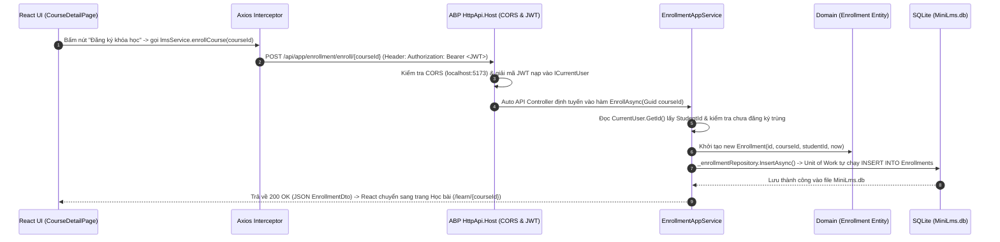
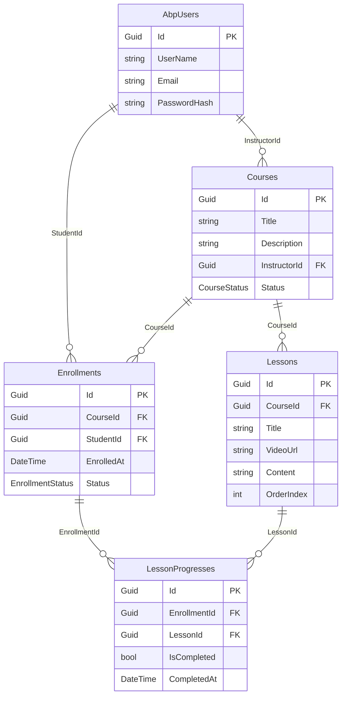

# 🎓 CẨM NANG THỰC HÀNH XÂY DỰNG DỰ ÁN MINI LMS TỪ BACKEND ĐẾN FRONTEND

> **Vai trò hướng dẫn:** Senior Fullstack Developer & Technical Mentor  
> **Tech Stack:** C# / .NET 8 • ABP Framework (Clean Architecture & DDD) • EF Core & SQLite • React 18 + TypeScript + Axios  
> **Cơ sở dữ liệu (5 bảng cốt lõi):** `AbpUsers`, `Courses`, `Lessons`, `Enrollments`, `LessonProgresses`

---

## 📑 MỤC LỤC

- [Phần 1: Tổng quan kiến trúc & Luồng đi của dữ liệu (End-to-End Flow)](#phần-1-tổng-quan-kiến-trúc--luồng-đi-của-dữ-liệu-end-to-end-flow)
  - [1.1. Trách nhiệm của từng tầng trong ABP Framework và React](#11-trách-nhiệm-của-từng-tầng-trong-abp-framework-và-react)
  - [1.2. Hành trình End-to-End của một Request](#12-hành-trình-end-to-end-của-một-request)
  - [1.3. Bảng tổng hợp toàn bộ danh sách file cần tạo](#13-bảng-tổng-hợp-toàn-bộ-danh-sách-file-cần-tạo)
- [Phần 2: Quy trình code Backend từng bước (ABP Framework + SQLite)](#phần-2-quy-trình-code-backend-từng-bước-abp-framework--sqlite)
  - [Bước 1 – Khởi tạo Solution & Cấu hình SQLite](#bước-1--khởi-tạo-solution--cấu-hình-sqlite)
  - [Bước 2 – Tầng Domain: Thiết kế 4 Entity & Liên kết với AbpUsers](#bước-2--tầng-domain-thiết-kế-4-entity--liên-kết-với-abpusers)
  - [Bước 3 – Tầng EntityFrameworkCore: DbContext, Migration & Seed Data](#bước-3--tầng-entityframeworkcore-dbcontext-migration--seed-data)
  - [Bước 4 – Tầng Application & API: DTOs, AppService, Auto API & Swagger](#bước-4--tầng-application--api-dtos-appservice-auto-api--swagger)
- [Phần 3: Quy trình code Frontend từng bước (React + TypeScript)](#phần-3-quy-trình-code-frontend-từng-bước-react--typescript)
  - [Bước 1 – Cấu trúc thư mục & Cấu hình Axios Interceptor](#bước-1--cấu-trúc-thư-mục--cấu-hình-axios-interceptor)
  - [Bước 2 – Luồng xác thực (Authentication) với OpenIddict](#bước-2--luồng-xác-thực-authentication-với-openiddict)
  - [Bước 3 – Xây dựng 3 màn hình chức năng cốt lõi](#bước-3--xây-dựng-3-màn-hình-chức-năng-cốt-lõi)
- [Phần 4: Kết nối & Xử lý lỗi thường gặp cho người mới](#phần-4-kết-nối--xử-lý-lỗi-thường-gặp-cho-người-mới)
  - [4.1. Cấu hình CORS giữa React và ABP Framework](#41-cấu-hình-cors-giữa-react-và-abp-framework)
  - [4.2. Cách đọc lỗi HTTP (400, 401, 403, 404, 500) và Debug](#42-cách-đọc-lỗi-http-400-401-403-404-500-và-debug)

---

# PHẦN 1: TỔNG QUAN KIẾN TRÚC & LUỒNG ĐI CỦA DỮ LIỆU (END-TO-END FLOW)

## 1.1. Trách nhiệm của từng tầng trong ABP Framework và React

Khi mới học ABP Framework, bạn sẽ thấy một Solution có nhiều project con. Thực chất, ABP chia nhỏ theo triết lý **Clean Architecture & Domain-Driven Design (DDD)** — mỗi tầng chỉ giữ đúng **một trách nhiệm duy nhất**:

| Tầng / Project | Vai trò chính | Trách nhiệm cụ thể trong dự án Mini LMS |
| :--- | :--- | :--- |
| **`MiniLms.Domain.Shared`** | Hằng số & Enum dùng chung | Chứa các Enum (`CourseStatus`, `EnrollmentStatus`). Không phụ thuộc vào bất kỳ project nào khác. |
| **`MiniLms.Domain`** | Trái tim nghiệp vụ (Core) | Chứa các thực thể (`Course`, `Lesson`, `Enrollment`, `LessonProgress`), quy tắc nghiệp vụ và `DataSeedContributor`. Hoàn toàn không biết DB là SQLite hay SQL Server. |
| **`MiniLms.EntityFrameworkCore`** | Giao tiếp Cơ sở dữ liệu | Chứa `MiniLmsDbContext`, cấu hình Fluent API ánh xạ các Entity xuống 5 bảng trong file SQLite (`MiniLms.db`) và lưu trữ các file `Migrations`. |
| **`MiniLms.Application.Contracts`** | Hợp đồng dữ liệu (DTO & Interface) | Chứa các DTO (`CourseDto`, `EnrollmentDto`, `CourseLearningDto`) và các Interface (`ICourseAppService`, `IEnrollmentAppService`). |
| **`MiniLms.Application`** | Xử lý ca sử dụng (Use Cases) | Chứa `CourseAppService` và `EnrollmentAppService`. Nơi nhận yêu cầu từ người dùng, gọi `IRepository` đọc/ghi dữ liệu và chuyển đổi sang `DTO`. |
| **`MiniLms.HttpApi.Host`** | Cổng Web Server & Bảo mật | Chạy Web Server, tích hợp **OpenIddict** cấp phát JWT Token, kiểm tra CORS, hiển thị **Swagger UI** và tự động biến `AppService` thành RESTful API (**Auto API Controllers**). |
| **`React Frontend (Vite + TS)`** | Giao diện người dùng (SPA) | Hiển thị màn hình cho Học viên/Giảng viên, lưu trữ JWT Token sau khi đăng nhập, dùng **Axios Interceptor** đính kèm Token gọi lên Backend và cập nhật giao diện. |

---

## 1.2. Hành trình End-to-End của một Request

Hãy theo dõi kịch bản thực tế: **Học viên bấm nút "Đăng ký khóa học (Enroll)" trên giao diện React**:



---

## 1.3. Bảng tổng hợp toàn bộ danh sách file cần tạo

Dùng bảng dưới đây làm **Checklist** trong quá trình bạn tự tay code:

| Phân hệ / Tầng | Đường dẫn File | Chức năng chính |
| :--- | :--- | :--- |
| **Domain.Shared** | `backend/src/MiniLms.Domain.Shared/Courses/CourseStatus.cs` | Enum trạng thái khóa học (`Draft`, `Published`, `Archived`) |
| **Domain.Shared** | `backend/src/MiniLms.Domain.Shared/Enrollments/EnrollmentStatus.cs` | Enum trạng thái đăng ký (`Active`, `Completed`) |
| **Domain** | `backend/src/MiniLms.Domain/Courses/Course.cs` | AggregateRoot bảng `Courses` (FK `InstructorId` -> `AbpUsers.Id`) |
| **Domain** | `backend/src/MiniLms.Domain/Courses/Lesson.cs` | Entity bảng `Lessons` (FK `CourseId` -> `Courses.Id`) |
| **Domain** | `backend/src/MiniLms.Domain/Enrollments/Enrollment.cs` | AggregateRoot bảng `Enrollments` (FK `StudentId` -> `AbpUsers.Id`) |
| **Domain** | `backend/src/MiniLms.Domain/Enrollments/LessonProgress.cs` | Entity bảng `LessonProgresses` (theo dõi từng bài đã hoàn thành) |
| **Domain** | `backend/src/MiniLms.Domain/Data/MiniLmsDataSeedContributor.cs` | Tự động tạo tài khoản `instructor`, `student` và 2 khóa học mẫu |
| **EF Core** | `backend/src/MiniLms.EntityFrameworkCore/EntityFrameworkCore/MiniLmsDbContext.cs` | Khai báo 4 `DbSet`, cấu hình Fluent API, Foreign Keys & Unique Index |
| **EF Core** | `backend/src/MiniLms.EntityFrameworkCore/EntityFrameworkCore/MiniLmsEntityFrameworkCoreModule.cs` | Bật `includeAllEntities: true` để tạo Repository cho cả Entity con |
| **App.Contracts** | `backend/src/MiniLms.Application.Contracts/Courses/Dtos/CourseDtos.cs` | DTO cho khóa học & bài học (`CourseDto`, `LessonDto`, `CreateUpdate...`) |
| **App.Contracts** | `backend/src/MiniLms.Application.Contracts/Enrollments/Dtos/EnrollmentDtos.cs` | DTO cho đăng ký học & tiến độ (`EnrollmentDto`, `CourseLearningDto`...) |
| **App.Contracts** | `backend/src/MiniLms.Application.Contracts/Courses/ICourseAppService.cs` | Interface định nghĩa các API khóa học |
| **App.Contracts** | `backend/src/MiniLms.Application.Contracts/Enrollments/IEnrollmentAppService.cs` | Interface định nghĩa các API đăng ký học & đánh dấu hoàn thành bài |
| **Application** | `backend/src/MiniLms.Application/Courses/CourseAppService.cs` | Xử lý nghiệp vụ xem danh sách, chi tiết và tạo khóa học/bài học |
| **Application** | `backend/src/MiniLms.Application/Enrollments/EnrollmentAppService.cs` | Xử lý nghiệp vụ đăng ký học, xem bài giảng và lưu tiến độ hoàn thành |
| **HttpApi.Host** | `backend/src/MiniLms.HttpApi.Host/appsettings.json` | Cấu hình chuỗi kết nối SQLite (`Data Source=../MiniLms.db`) & `CorsOrigins` |
| **React (TS)** | `frontend/src/types/lms.ts` | Định nghĩa TypeScript Interfaces khớp 1-1 với DTO của Backend |
| **React (TS)** | `frontend/src/api/axiosClient.ts` | Cấu hình Axios tập trung + Interceptor tự động đính kèm JWT Token |
| **React (TS)** | `frontend/src/api/authService.ts` | Gọi API đăng nhập OpenIddict (`/connect/token`) và lưu token |
| **React (TS)** | `frontend/src/api/lmsService.ts` | Gọi các REST API `/api/app/course` và `/api/app/enrollment` |
| **React (TS)** | `frontend/src/context/AuthContext.tsx` | Quản lý trạng thái đăng nhập toàn cục cho ứng dụng React |
| **React (TS)** | `frontend/src/components/ProtectedRoute.tsx` | Bảo vệ các trang yêu cầu đăng nhập (như phòng học bài) |
| **React (TS)** | `frontend/src/pages/LoginPage.tsx` | Trang đăng nhập học viên / giảng viên |
| **React (TS)** | `frontend/src/pages/CourseListPage.tsx` | **Màn hình 1:** Danh sách khóa học (`Courses`) |
| **React (TS)** | `frontend/src/pages/CourseDetailPage.tsx` | **Màn hình 2:** Chi tiết khóa học & Nút đăng ký học (`Enrollments`) |
| **React (TS)** | `frontend/src/pages/LessonPlayerPage.tsx` | **Màn hình 3:** Học bài & Đánh dấu hoàn thành (`Lessons` & `LessonProgresses`) |
| **React (TS)** | `frontend/src/App.tsx` | Cấu hình React Router & Thanh điều hướng (Navbar) |

---

# PHẦN 2: QUY TRÌNH CODE BACKEND TỪNG BƯỚC (ABP FRAMEWORK + SQLITE)

## Bước 1 – Khởi tạo Solution & Cấu hình SQLite

### 1.1. Lệnh khởi tạo Solution bằng ABP CLI

Mở Terminal / PowerShell tại thư mục gốc `D:\Mini_Project_LMS` và chạy lệnh:

```powershell
# 1. Cài đặt ABP CLI (nếu máy bạn chưa cài)
dotnet tool install -g Volo.Abp.Cli

# 2. Khởi tạo Solution ABP chuẩn với SQLite trong thư mục backend/
# Giải thích các cờ (flags):
#   -t app       : Sử dụng mẫu Application phân tầng chuẩn DDD
#   -u none      : Không sinh giao diện MVC phía Backend (vì ta dùng React độc lập)
#   -dbms SQLite : Tự động cài đặt gói Volo.Abp.EntityFrameworkCore.Sqlite
#   -o backend   : Đặt toàn bộ mã nguồn vào thư mục backend/
abp new MiniLms -t app -u none -dbms SQLite -o backend
```

### 1.2. Cấu hình chuỗi kết nối SQLite (`appsettings.json`)

Mở cả 2 file:
- `backend/src/MiniLms.HttpApi.Host/appsettings.json`
- `backend/src/MiniLms.DbMigrator/appsettings.json`

Cập nhật mục `ConnectionStrings` và `App:CorsOrigins` như sau:

```json
{
  "App": {
    "SelfUrl": "https://localhost:44300",
    "CorsOrigins": "http://localhost:5173,https://localhost:5173,http://localhost:3000"
  },
  "ConnectionStrings": {
    "Default": "Data Source=../MiniLms.db;Mode=ReadWriteCreate"
  },
  "AuthServer": {
    "Authority": "https://localhost:44300",
    "RequireHttpsMetadata": "false",
    "SwaggerClientId": "MiniLms_Swagger"
  }
}
```

> [!TIP]
> **💡 TẠI SAO để `Data Source=../MiniLms.db`?**  
> Project `MiniLms.DbMigrator` (dùng để tạo bảng & bơm dữ liệu mẫu) và `MiniLms.HttpApi.Host` (chạy Web API) nằm ở 2 thư mục con khác nhau bên trong `backend/src/`. Khi đặt `Data Source=../MiniLms.db`, cả hai project sẽ cùng trỏ tới **đúng 1 file SQLite duy nhất** nằm tại `backend/src/MiniLms.db`.

> [!IMPORTANT]
> **✅ CÁCH KIỂM TRA KẾT QUẢ — BƯỚC 1:**
> 1. Mở terminal tại `backend/`, chạy `dotnet build` → Báo **Build succeeded. 0 Error(s)**.
> 2. Chạy `dotnet run --project src/MiniLms.DbMigrator` → Thấy file `MiniLms.db` được tạo ra cùng bảng `AbpUsers` mặc định của ABP.

---

## Bước 2 – Tầng Domain: Thiết kế 4 Entity & Liên kết với `AbpUsers`

Hệ thống của chúng ta gồm **5 bảng cốt lõi**:



> [!NOTE]
> **💡 GIẢI THÍCH BẢN CHẤT (TẠI SAO?):**
> 1. **Tại sao `Course` và `Enrollment` kế thừa `FullAuditedAggregateRoot<Guid>`, còn `Lesson` và `LessonProgress` kế thừa `FullAuditedEntity<Guid>` / `Entity<Guid>`?**
>    - Trong DDD, **AggregateRoot** là thực thể gốc đứng đầu một cụm nghiệp vụ (`Course` quản lý các `Lesson`; `Enrollment` quản lý các `LessonProgress`).
>    - Khi kế thừa `FullAudited...`, ABP tự động thêm các cột `CreationTime`, `CreatorId`, `LastModificationTime`, và đặc biệt là `IsDeleted` (**Soft Delete / Xóa mềm** — khi xóa dữ liệu không mất khỏi SQLite mà chỉ đánh dấu `IsDeleted = 1`, và ABP tự động lọc bỏ các dòng đã xóa mềm trong mọi câu truy vấn!).
> 2. **Tại sao liên kết với bảng `AbpUsers` chỉ khai báo `public Guid InstructorId { get; private set; }` mà không khai báo `public IdentityUser Instructor`?**
>    - Trong kiến trúc module của ABP, bảng `AbpUsers` thuộc module `Identity`. Việc chỉ giữ khóa ngoại kiểu `Guid` (`InstructorId`, `StudentId`) ở tầng Domain giúp các thực thể của bạn độc lập, gọn nhẹ, tránh phụ thuộc vòng, nhưng vẫn tạo được ràng buộc khóa ngoại (Foreign Key) thật dưới SQLite ở Bước 3.

### 2.1. Tạo các Enum trạng thái tại tầng `Domain.Shared`

📄 **File:** `backend/src/MiniLms.Domain.Shared/Courses/CourseStatus.cs`
```csharp
namespace MiniLms.Courses;

/// <summary>
/// Trạng thái khóa học. Đặt ở Domain.Shared để cả tầng Domain và tầng Application (DTO) đều dùng chung được.
/// </summary>
public enum CourseStatus
{
    Draft = 0,      // Bản nháp (Học viên chưa nhìn thấy)
    Published = 1,  // Đang mở đăng ký (Hiển thị công khai)
    Archived = 2    // Đã đóng / Lưu trữ
}
```

📄 **File:** `backend/src/MiniLms.Domain.Shared/Enrollments/EnrollmentStatus.cs`
```csharp
namespace MiniLms.Enrollments;

/// <summary>
/// Trạng thái tham gia khóa học của học viên.
/// </summary>
public enum EnrollmentStatus
{
    Active = 0,     // Đang học
    Completed = 1   // Đã hoàn thành 100% bài học trong khóa
}
```

### 2.2. Tạo thực thể `Course` và `Lesson` tại tầng `Domain`

📄 **File:** `backend/src/MiniLms.Domain/Courses/Course.cs`
```csharp
using System;
using System.Collections.Generic;
using Volo.Abp;
using Volo.Abp.Domain.Entities.Auditing;

namespace MiniLms.Courses;

/// <summary>
/// Bảng Courses: Lưu thông tin khóa học.
/// Kế thừa FullAuditedAggregateRoot<Guid> để có sẵn khóa chính Id (Guid) và các cột lịch sử/xóa mềm.
/// </summary>
public class Course : FullAuditedAggregateRoot<Guid>
{
    public string Title { get; private set; } = string.Empty;
    public string Description { get; private set; } = string.Empty;

    // Khóa ngoại (FK) trỏ tới bảng AbpUsers.Id (Tài khoản Giảng viên tạo khóa học)
    public Guid InstructorId { get; private set; }

    public CourseStatus Status { get; private set; }

    // Quan hệ 1-N: Một khóa học bao gồm nhiều bài học
    public ICollection<Lesson> Lessons { get; private set; } = new List<Lesson>();

    // WHY: EF Core bắt buộc phải có constructor không tham số (protected/private) để nạp dữ liệu từ SQLite lên RAM
    protected Course() { }

    public Course(
        Guid id,
        string title,
        string description,
        Guid instructorId,
        CourseStatus status = CourseStatus.Published)
        : base(id)
    {
        SetTitle(title);
        Description = description ?? string.Empty;
        InstructorId = instructorId;
        Status = status;
    }

    // WHY: Dùng private set + hàm SetTitle để bảo vệ quy tắc nghiệp vụ: Tên khóa học không bao giờ được rỗng
    public void SetTitle(string title)
    {
        Title = Check.NotNullOrWhiteSpace(title, nameof(title), maxLength: 200);
    }

    public void UpdateInfo(string title, string description, CourseStatus status)
    {
        SetTitle(title);
        Description = description ?? string.Empty;
        Status = status;
    }
}
```

📄 **File:** `backend/src/MiniLms.Domain/Courses/Lesson.cs`
```csharp
using System;
using Volo.Abp;
using Volo.Abp.Domain.Entities.Auditing;

namespace MiniLms.Courses;

/// <summary>
/// Bảng Lessons: Lưu thông tin từng bài giảng thuộc một khóa học.
/// </summary>
public class Lesson : FullAuditedEntity<Guid>
{
    // Khóa ngoại (FK) trỏ tới bảng Courses.Id
    public Guid CourseId { get; private set; }

    public string Title { get; private set; } = string.Empty;
    public string VideoUrl { get; private set; } = string.Empty;
    public string Content { get; private set; } = string.Empty;

    // Thứ tự bài học trong khóa (1, 2, 3...)
    public int OrderIndex { get; private set; }

    protected Lesson() { }

    public Lesson(Guid id, Guid courseId, string title, string videoUrl, string content, int orderIndex)
        : base(id)
    {
        CourseId = courseId;
        Title = Check.NotNullOrWhiteSpace(title, nameof(title), maxLength: 200);
        VideoUrl = videoUrl ?? string.Empty;
        Content = content ?? string.Empty;
        OrderIndex = orderIndex;
    }
}
```

### 2.3. Tạo thực thể `Enrollment` và `LessonProgress` tại tầng `Domain`

📄 **File:** `backend/src/MiniLms.Domain/Enrollments/Enrollment.cs`
```csharp
using System;
using System.Collections.Generic;
using System.Linq;
using Volo.Abp.Domain.Entities.Auditing;

namespace MiniLms.Enrollments;

/// <summary>
/// Bảng Enrollments: Ghi nhận lượt đăng ký khóa học của một Học viên.
/// </summary>
public class Enrollment : FullAuditedAggregateRoot<Guid>
{
    // Khóa ngoại (FK) trỏ tới bảng Courses.Id
    public Guid CourseId { get; private set; }

    // Khóa ngoại (FK) trỏ tới bảng AbpUsers.Id (Tài khoản Học viên)
    public Guid StudentId { get; private set; }

    public DateTime EnrolledAt { get; private set; }
    public EnrollmentStatus Status { get; private set; }

    // Quan hệ 1-N: Một lượt đăng ký theo dõi tiến độ của nhiều bài học
    public ICollection<LessonProgress> LessonProgresses { get; private set; } = new List<LessonProgress>();

    protected Enrollment() { }

    public Enrollment(Guid id, Guid courseId, Guid studentId, DateTime enrolledAt)
        : base(id)
    {
        CourseId = courseId;
        StudentId = studentId;
        EnrolledAt = enrolledAt;
        Status = EnrollmentStatus.Active;
    }

    /// <summary>
    /// Quy tắc nghiệp vụ: Tự động chuyển trạng thái khóa học sang Completed khi hoàn thành đủ số bài học.
    /// </summary>
    public void RecalculateCompletionStatus(int totalLessonsInCourse)
    {
        if (totalLessonsInCourse <= 0) return;

        var completedCount = LessonProgresses.Count(x => x.IsCompleted);
        Status = completedCount >= totalLessonsInCourse
            ? EnrollmentStatus.Completed
            : EnrollmentStatus.Active;
    }
}
```

📄 **File:** `backend/src/MiniLms.Domain/Enrollments/LessonProgress.cs`
```csharp
using System;
using Volo.Abp.Domain.Entities;

namespace MiniLms.Enrollments;

/// <summary>
/// Bảng LessonProgresses: Lưu trạng thái hoàn thành của từng bài học theo lượt đăng ký.
/// </summary>
public class LessonProgress : Entity<Guid>
{
    // Khóa ngoại (FK) trỏ tới bảng Enrollments.Id
    public Guid EnrollmentId { get; private set; }

    // Khóa ngoại (FK) trỏ tới bảng Lessons.Id
    public Guid LessonId { get; private set; }

    public bool IsCompleted { get; private set; }
    public DateTime? CompletedAt { get; private set; }

    protected LessonProgress() { }

    public LessonProgress(Guid id, Guid enrollmentId, Guid lessonId, bool isCompleted = false)
        : base(id)
    {
        EnrollmentId = enrollmentId;
        LessonId = lessonId;
        SetCompletion(isCompleted);
    }

    public void SetCompletion(bool isCompleted)
    {
        IsCompleted = isCompleted;
        CompletedAt = isCompleted ? DateTime.UtcNow : null;
    }
}
```

> [!IMPORTANT]
> **✅ CÁCH KIỂM TRA KẾT QUẢ — BƯỚC 2:**
> - Chạy lệnh: `dotnet build src/MiniLms.Domain/MiniLms.Domain.csproj`
> - Kết quả phải báo **Build succeeded. 0 Error(s)**.

---

## Bước 3 – Tầng EntityFrameworkCore: DbContext, Migration & Seed Data

### 3.1. Cấu hình `DbSet` và Fluent API trong `MiniLmsDbContext.cs`

📄 **File:** `backend/src/MiniLms.EntityFrameworkCore/EntityFrameworkCore/MiniLmsDbContext.cs`
```csharp
using Microsoft.EntityFrameworkCore;
using MiniLms.Courses;
using MiniLms.Enrollments;
using Volo.Abp.Data;
using Volo.Abp.DependencyInjection;
using Volo.Abp.EntityFrameworkCore;
using Volo.Abp.EntityFrameworkCore.Modeling;
using Volo.Abp.Identity;
using Volo.Abp.Identity.EntityFrameworkCore;
using Volo.Abp.OpenIddict.EntityFrameworkCore;

namespace MiniLms.EntityFrameworkCore;

[ReplaceDbContext(typeof(IIdentityDbContext))]
[ConnectionStringName("Default")]
public class MiniLmsDbContext :
    AbpDbContext<MiniLmsDbContext>,
    IIdentityDbContext
{
    // 1. Khai báo 4 bảng nghiệp vụ của Mini LMS
    public DbSet<Course> Courses { get; set; }
    public DbSet<Lesson> Lessons { get; set; }
    public DbSet<Enrollment> Enrollments { get; set; }
    public DbSet<LessonProgress> LessonProgresses { get; set; }

    // Các DbSet mặc định của module Identity (AbpUsers, AbpRoles...)
    public DbSet<IdentityUser> Users { get; set; }
    public DbSet<IdentityRole> Roles { get; set; }
    public DbSet<IdentityClaimType> ClaimTypes { get; set; }
    public DbSet<OrganizationUnit> OrganizationUnits { get; set; }
    public DbSet<IdentitySecurityLog> SecurityLogs { get; set; }
    public DbSet<IdentityLinkUser> LinkUsers { get; set; }
    public DbSet<IdentityUserDelegation> UserDelegations { get; set; }
    public DbSet<IdentitySession> Sessions { get; set; }

    public MiniLmsDbContext(DbContextOptions<MiniLmsDbContext> options)
        : base(options)
    {
    }

    protected override void OnModelCreating(ModelBuilder builder)
    {
        base.OnModelCreating(builder);

        builder.ConfigureIdentity();
        builder.ConfigureOpenIddict();
        // (Giữ nguyên các dòng builder.ConfigurePermissionManagement(), SettingManagement()... có sẵn của template)

        // =====================================================================
        // CẤU HÌNH 4 BẢNG NGHIỆP VỤ MINI LMS
        // =====================================================================

        // 1. Bảng Courses
        builder.Entity<Course>(b =>
        {
            b.ToTable("Courses");
            b.ConfigureByConvention(); // WHY: Tự động cấu hình các cột chuẩn của ABP (Id, CreationTime, IsDeleted...)

            b.Property(x => x.Title).IsRequired().HasMaxLength(200);
            b.Property(x => x.Description).HasMaxLength(2000);

            // Khóa ngoại: Courses.InstructorId -> AbpUsers.Id
            b.HasOne<IdentityUser>()
                .WithMany()
                .HasForeignKey(x => x.InstructorId)
                .OnDelete(DeleteBehavior.Restrict);

            // Quan hệ 1-N: Course -> Lessons
            b.HasMany(x => x.Lessons)
                .WithOne()
                .HasForeignKey(x => x.CourseId)
                .OnDelete(DeleteBehavior.Cascade);
        });

        // 2. Bảng Lessons
        builder.Entity<Lesson>(b =>
        {
            b.ToTable("Lessons");
            b.ConfigureByConvention();

            b.Property(x => x.Title).IsRequired().HasMaxLength(200);
            b.Property(x => x.VideoUrl).HasMaxLength(500);
            b.HasIndex(x => new { x.CourseId, x.OrderIndex });
        });

        // 3. Bảng Enrollments
        builder.Entity<Enrollment>(b =>
        {
            b.ToTable("Enrollments");
            b.ConfigureByConvention();

            // Khóa ngoại: Enrollments.CourseId -> Courses.Id
            b.HasOne<Course>()
                .WithMany()
                .HasForeignKey(x => x.CourseId)
                .OnDelete(DeleteBehavior.Cascade);

            // Khóa ngoại: Enrollments.StudentId -> AbpUsers.Id
            b.HasOne<IdentityUser>()
                .WithMany()
                .HasForeignKey(x => x.StudentId)
                .OnDelete(DeleteBehavior.Restrict);

            // WHY: Unique Index đảm bảo 1 học viên không bao giờ đăng ký trùng 2 lần vào cùng 1 khóa học
            b.HasIndex(x => new { x.CourseId, x.StudentId }).IsUnique();

            // Quan hệ 1-N: Enrollment -> LessonProgresses
            b.HasMany(x => x.LessonProgresses)
                .WithOne()
                .HasForeignKey(x => x.EnrollmentId)
                .OnDelete(DeleteBehavior.Cascade);
        });

        // 4. Bảng LessonProgresses
        builder.Entity<LessonProgress>(b =>
        {
            b.ToTable("LessonProgresses");
            b.ConfigureByConvention();

            // Khóa ngoại: LessonProgresses.LessonId -> Lessons.Id
            b.HasOne<Lesson>()
                .WithMany()
                .HasForeignKey(x => x.LessonId)
                .OnDelete(DeleteBehavior.Cascade);

            // Mỗi bài học trong 1 lượt đăng ký chỉ có duy nhất 1 bản ghi tiến độ
            b.HasIndex(x => new { x.EnrollmentId, x.LessonId }).IsUnique();
        });
    }
}
```

### 3.2. Kiểm tra đăng ký Repository cho các Entity con

Mở file `backend/src/MiniLms.EntityFrameworkCore/EntityFrameworkCore/MiniLmsEntityFrameworkCoreModule.cs` và đảm bảo `includeAllEntities: true` đã được bật:

```csharp
context.Services.AddAbpDbContext<MiniLmsDbContext>(options =>
{
    // WHY: includeAllEntities: true giúp ABP tạo sẵn IRepository cho cả Entity con (Lesson, LessonProgress)
    // chứ không chỉ riêng AggregateRoot (Course, Enrollment).
    options.AddDefaultRepositories(includeAllEntities: true);
});
```

### 3.3. Viết `IDataSeedContributor` để tạo tài khoản & khóa học mẫu

📄 **File:** `backend/src/MiniLms.Domain/Data/MiniLmsDataSeedContributor.cs`
```csharp
using System;
using System.Threading.Tasks;
using MiniLms.Courses;
using Volo.Abp.Data;
using Volo.Abp.DependencyInjection;
using Volo.Abp.Domain.Repositories;
using Volo.Abp.Guids;
using Volo.Abp.Identity;

namespace MiniLms.Data;

/// <summary>
/// Tự động tạo tài khoản mẫu (instructor, student) và 2 khóa học mẫu khi chạy DbMigrator.
/// </summary>
public class MiniLmsDataSeedContributor : IDataSeedContributor, ITransientDependency
{
    private readonly IRepository<Course, Guid> _courseRepository;
    private readonly IRepository<Lesson, Guid> _lessonRepository;
    private readonly IdentityUserManager _userManager;
    private readonly IGuidGenerator _guidGenerator;

    public MiniLmsDataSeedContributor(
        IRepository<Course, Guid> courseRepository,
        IRepository<Lesson, Guid> lessonRepository,
        IdentityUserManager userManager,
        IGuidGenerator guidGenerator)
    {
        _courseRepository = courseRepository;
        _lessonRepository = lessonRepository;
        _userManager = userManager;
        _guidGenerator = guidGenerator;
    }

    public async Task SeedAsync(DataSeedContext context)
    {
        // 1. Tạo tài khoản Giảng viên mẫu vào bảng AbpUsers
        var instructor = await _userManager.FindByNameAsync("instructor");
        if (instructor == null)
        {
            instructor = new IdentityUser(_guidGenerator.Create(), "instructor", "instructor@minilms.local");
            // WHY: IdentityUserManager tự động sinh chuỗi Salt ngẫu nhiên và băm mật khẩu 1 chiều bằng PBKDF2
            await _userManager.CreateAsync(instructor, "1q2w3E*");
        }

        // 2. Tạo tài khoản Học viên mẫu vào bảng AbpUsers
        var student = await _userManager.FindByNameAsync("student");
        if (student == null)
        {
            student = new IdentityUser(_guidGenerator.Create(), "student", "student@minilms.local");
            await _userManager.CreateAsync(student, "1q2w3E*");
        }

        // 3. Nếu đã có khóa học rồi thì không seed lại nữa
        if (await _courseRepository.GetCountAsync() > 0)
        {
            return;
        }

        // 4. Tạo Khóa học mẫu số 1
        var course1 = await _courseRepository.InsertAsync(
            new Course(
                _guidGenerator.Create(),
                "Làm chủ ABP Framework & Clean Architecture với .NET 8",
                "Khóa học thực chiến giúp bạn nắm vững kiến trúc DDD, EF Core SQLite và Auto API Controllers.",
                instructor.Id,
                CourseStatus.Published
            ),
            autoSave: true
        );

        await _lessonRepository.InsertAsync(new Lesson(
            _guidGenerator.Create(), course1.Id,
            "Bài 1: Tổng quan kiến trúc phân tầng trong ABP Framework",
            "https://www.youtube.com/embed/dQw4w9WgXcQ",
            "Tìm hiểu trách nhiệm của các tầng Domain, Application, EntityFrameworkCore và HttpApi.Host.",
            orderIndex: 1
        ), autoSave: true);

        await _lessonRepository.InsertAsync(new Lesson(
            _guidGenerator.Create(), course1.Id,
            "Bài 2: Thiết kế AggregateRoot, Entity và cấu hình EF Core SQLite",
            "https://www.youtube.com/embed/dQw4w9WgXcQ",
            "Cách xây dựng các bảng Courses, Lessons, Enrollments, LessonProgresses và tạo Code-First Migration.",
            orderIndex: 2
        ), autoSave: true);

        await _lessonRepository.InsertAsync(new Lesson(
            _guidGenerator.Create(), course1.Id,
            "Bài 3: Xây dựng Application Service, DTO và Auto API Controllers",
            "https://www.youtube.com/embed/dQw4w9WgXcQ",
            "Cách ABP tự động biến các phương thức C# trong AppService thành RESTful API chuẩn.",
            orderIndex: 3
        ), autoSave: true);

        // 5. Tạo Khóa học mẫu số 2
        var course2 = await _courseRepository.InsertAsync(
            new Course(
                _guidGenerator.Create(),
                "Xây dựng SPA hiện đại với React 18, TypeScript & Axios",
                "Hướng dẫn kết nối React Frontend với hệ thống Backend ABP qua JWT Authentication và Axios Interceptor.",
                instructor.Id,
                CourseStatus.Published
            ),
            autoSave: true
        );

        await _lessonRepository.InsertAsync(new Lesson(
            _guidGenerator.Create(), course2.Id,
            "Bài 1: Cấu hình Axios Interceptor tự động đính kèm JWT Token",
            "https://www.youtube.com/embed/dQw4w9WgXcQ",
            "Thiết lập HTTP Client tập trung giúp mọi request gửi lên ABP đều có Header Authorization.",
            orderIndex: 1
        ), autoSave: true);

        await _lessonRepository.InsertAsync(new Lesson(
            _guidGenerator.Create(), course2.Id,
            "Bài 2: Quản lý trạng thái học tập và tiến độ bài học (LessonProgress)",
            "https://www.youtube.com/embed/dQw4w9WgXcQ",
            "Sử dụng React Hooks (useState, useEffect) để hiển thị bài giảng và cập nhật phần trăm hoàn thành.",
            orderIndex: 2
        ), autoSave: true);
    }
}
```

### 3.4. Tạo và chạy Code-First Migration trên SQLite

Chạy 2 lệnh sau tại thư mục `backend/`:

```powershell
# 1. Sinh file Migration cho 4 bảng Courses, Lessons, Enrollments, LessonProgresses
dotnet ef migrations add Added_MiniLms_Entities --project src/MiniLms.EntityFrameworkCore --startup-project src/MiniLms.HttpApi.Host

# 2. Áp dụng Migration vào file MiniLms.db VÀ chạy MiniLmsDataSeedContributor
dotnet run --project src/MiniLms.DbMigrator
```

> [!IMPORTANT]
> **✅ CÁCH KIỂM TRA KẾT QUẢ — BƯỚC 3:**
> 1. Trong `backend/src/MiniLms.EntityFrameworkCore/Migrations/` xuất hiện file `*_Added_MiniLms_Entities.cs`.
> 2. Mở file `MiniLms.db` bằng extension **SQLite Viewer** trên VS Code: kiểm tra thấy đủ 5 bảng `AbpUsers`, `Courses`, `Lessons`, `Enrollments`, `LessonProgresses`; bảng `Courses` có sẵn 2 khóa học và bảng `Lessons` có sẵn 5 bài học mẫu.

---

## Bước 4 – Tầng Application & API: DTOs, AppService, Auto API & Swagger

> [!TIP]
> **💡 TẠI SAO phải tạo DTO (`Data Transfer Object`) mà không trả thẳng Entity (`Course`, `IdentityUser`) ra API?**
> 1. **Bảo mật:** Entity `IdentityUser` (`AbpUsers`) chứa cột `PasswordHash`, `SecurityStamp`. Nếu trả thẳng Entity ra API, toàn bộ chuỗi hash mật khẩu sẽ bị lộ ra ngoài JSON.
> 2. **Tránh lỗi vòng lặp JSON (`Circular Reference`):** Entity thường có tham chiếu 2 chiều. Trả thẳng Entity dễ làm bộ serialize JSON bị lặp vô tận gây lỗi HTTP `500`.
> 3. **Gói thêm dữ liệu tính toán cho UI:** React cần biết thêm trường `IsEnrolled` (học viên đã đăng ký khóa này chưa?) hoặc `ProgressPercent` (% tiến độ). Các trường này không nằm cố định trong bảng `Courses` mà được tính toán trong `AppService` rồi gán vào `CourseDto`.

### 4.1. Tạo các DTO và Interface tại tầng `Application.Contracts`

📄 **File:** `backend/src/MiniLms.Application.Contracts/Courses/Dtos/CourseDtos.cs`
```csharp
using System;
using System.Collections.Generic;
using System.ComponentModel.DataAnnotations;
using Volo.Abp.Application.Dtos;

namespace MiniLms.Courses.Dtos;

public class CourseDto : EntityDto<Guid>
{
    public string Title { get; set; } = string.Empty;
    public string Description { get; set; } = string.Empty;
    public Guid InstructorId { get; set; }
    public CourseStatus Status { get; set; }
    public DateTime CreationTime { get; set; }

    // Thông tin tổng hợp phục vụ trực tiếp cho giao diện React
    public int TotalLessons { get; set; }
    public bool IsEnrolled { get; set; }
    public Guid? EnrollmentId { get; set; }
    public List<LessonDto> Lessons { get; set; } = new();
}

public class LessonDto : EntityDto<Guid>
{
    public Guid CourseId { get; set; }
    public string Title { get; set; } = string.Empty;
    public string VideoUrl { get; set; } = string.Empty;
    public string Content { get; set; } = string.Empty;
    public int OrderIndex { get; set; }
}

public class CreateUpdateCourseDto
{
    [Required]
    [StringLength(200)]
    public string Title { get; set; } = string.Empty;

    [StringLength(2000)]
    public string Description { get; set; } = string.Empty;

    public CourseStatus Status { get; set; } = CourseStatus.Published;
}

public class CreateUpdateLessonDto
{
    [Required]
    public Guid CourseId { get; set; }

    [Required]
    [StringLength(200)]
    public string Title { get; set; } = string.Empty;

    public string VideoUrl { get; set; } = string.Empty;
    public string Content { get; set; } = string.Empty;
    public int OrderIndex { get; set; } = 1;
}
```

📄 **File:** `backend/src/MiniLms.Application.Contracts/Enrollments/Dtos/EnrollmentDtos.cs`
```csharp
using System;
using System.Collections.Generic;
using Volo.Abp.Application.Dtos;

namespace MiniLms.Enrollments.Dtos;

public class EnrollmentDto : EntityDto<Guid>
{
    public Guid CourseId { get; set; }
    public string CourseTitle { get; set; } = string.Empty;
    public Guid StudentId { get; set; }
    public DateTime EnrolledAt { get; set; }
    public EnrollmentStatus Status { get; set; }
    public int TotalLessons { get; set; }
    public int CompletedLessons { get; set; }
    public int ProgressPercent { get; set; }
}

public class CourseLearningDto
{
    public Guid EnrollmentId { get; set; }
    public Guid CourseId { get; set; }
    public string CourseTitle { get; set; } = string.Empty;
    public EnrollmentStatus Status { get; set; }
    public int TotalLessons { get; set; }
    public int CompletedLessons { get; set; }
    public int ProgressPercent { get; set; }
    public List<LessonWithProgressDto> Lessons { get; set; } = new();
}

public class LessonWithProgressDto
{
    public Guid LessonId { get; set; }
    public string Title { get; set; } = string.Empty;
    public string VideoUrl { get; set; } = string.Empty;
    public string Content { get; set; } = string.Empty;
    public int OrderIndex { get; set; }
    public bool IsCompleted { get; set; }
    public DateTime? CompletedAt { get; set; }
}

public class ToggleLessonProgressInput
{
    public Guid CourseId { get; set; }
    public Guid LessonId { get; set; }
    public bool IsCompleted { get; set; }
}
```

📄 **File:** `backend/src/MiniLms.Application.Contracts/Courses/ICourseAppService.cs`
```csharp
using System;
using System.Collections.Generic;
using System.Threading.Tasks;
using MiniLms.Courses.Dtos;
using Volo.Abp.Application.Services;

namespace MiniLms.Courses;

public interface ICourseAppService : IApplicationService
{
    Task<List<CourseDto>> GetListAsync();
    Task<CourseDto> GetAsync(Guid id);
    Task<CourseDto> CreateAsync(CreateUpdateCourseDto input);
    Task<LessonDto> AddLessonAsync(CreateUpdateLessonDto input);
}
```

📄 **File:** `backend/src/MiniLms.Application.Contracts/Enrollments/IEnrollmentAppService.cs`
```csharp
using System;
using System.Collections.Generic;
using System.Threading.Tasks;
using MiniLms.Enrollments.Dtos;
using Volo.Abp.Application.Services;

namespace MiniLms.Enrollments;

public interface IEnrollmentAppService : IApplicationService
{
    Task<EnrollmentDto> EnrollAsync(Guid courseId);
    Task<List<EnrollmentDto>> GetMyEnrollmentsAsync();
    Task<CourseLearningDto> GetLearningCourseAsync(Guid courseId);
    Task<CourseLearningDto> ToggleLessonProgressAsync(ToggleLessonProgressInput input);
}
```

### 4.2. Cài đặt `CourseAppService` và `EnrollmentAppService` tại tầng `Application`

📄 **File:** `backend/src/MiniLms.Application/Courses/CourseAppService.cs`
```csharp
using System;
using System.Collections.Generic;
using System.Linq;
using System.Threading.Tasks;
using Microsoft.AspNetCore.Authorization;
using MiniLms.Courses.Dtos;
using MiniLms.Enrollments;
using Volo.Abp.Application.Services;
using Volo.Abp.Domain.Repositories;
using Volo.Abp.Users;

namespace MiniLms.Courses;

/// <summary>
/// Quản lý Khóa học & Bài học.
/// WHY: Khi kế thừa ApplicationService, ABP tự động biến các hàm public trong class này thành RESTful API!
/// </summary>
public class CourseAppService : ApplicationService, ICourseAppService
{
    private readonly IRepository<Course, Guid> _courseRepository;
    private readonly IRepository<Lesson, Guid> _lessonRepository;
    private readonly IRepository<Enrollment, Guid> _enrollmentRepository;

    public CourseAppService(
        IRepository<Course, Guid> courseRepository,
        IRepository<Lesson, Guid> lessonRepository,
        IRepository<Enrollment, Guid> enrollmentRepository)
    {
        _courseRepository = courseRepository;
        _lessonRepository = lessonRepository;
        _enrollmentRepository = enrollmentRepository;
    }

    // Tự động sinh API: GET /api/app/course
    public async Task<List<CourseDto>> GetListAsync()
    {
        var courses = await _courseRepository.GetListAsync(x => x.Status == CourseStatus.Published);
        var lessons = await _lessonRepository.GetListAsync();

        var currentUserId = CurrentUser.Id;
        var myEnrollments = currentUserId.HasValue
            ? await _enrollmentRepository.GetListAsync(x => x.StudentId == currentUserId.Value)
            : new List<Enrollment>();

        return courses
            .OrderByDescending(c => c.CreationTime)
            .Select(c =>
            {
                var enrollment = myEnrollments.FirstOrDefault(e => e.CourseId == c.Id);
                return new CourseDto
                {
                    Id = c.Id,
                    Title = c.Title,
                    Description = c.Description,
                    InstructorId = c.InstructorId,
                    Status = c.Status,
                    CreationTime = c.CreationTime,
                    TotalLessons = lessons.Count(l => l.CourseId == c.Id),
                    IsEnrolled = enrollment != null,
                    EnrollmentId = enrollment?.Id
                };
            })
            .ToList();
    }

    // Tự động sinh API: GET /api/app/course/{id}
    public async Task<CourseDto> GetAsync(Guid id)
    {
        var course = await _courseRepository.GetAsync(id);
        var lessons = await _lessonRepository.GetListAsync(x => x.CourseId == id);

        Enrollment? enrollment = null;
        if (CurrentUser.Id.HasValue)
        {
            enrollment = await _enrollmentRepository.FirstOrDefaultAsync(
                x => x.CourseId == id && x.StudentId == CurrentUser.Id.Value);
        }

        return new CourseDto
        {
            Id = course.Id,
            Title = course.Title,
            Description = course.Description,
            InstructorId = course.InstructorId,
            Status = course.Status,
            CreationTime = course.CreationTime,
            TotalLessons = lessons.Count,
            IsEnrolled = enrollment != null,
            EnrollmentId = enrollment?.Id,
            Lessons = lessons
                .OrderBy(l => l.OrderIndex)
                .Select(l => new LessonDto
                {
                    Id = l.Id,
                    CourseId = l.CourseId,
                    Title = l.Title,
                    VideoUrl = l.VideoUrl,
                    Content = l.Content,
                    OrderIndex = l.OrderIndex
                })
                .ToList()
        };
    }

    // Tự động sinh API: POST /api/app/course
    [Authorize]
    public async Task<CourseDto> CreateAsync(CreateUpdateCourseDto input)
    {
        // WHY: Lấy Id của người đang đăng nhập từ JWT Token qua CurrentUser.GetId()
        var instructorId = CurrentUser.GetId();

        var course = new Course(
            GuidGenerator.Create(),
            input.Title,
            input.Description,
            instructorId,
            input.Status
        );

        await _courseRepository.InsertAsync(course, autoSave: true);
        return await GetAsync(course.Id);
    }

    // Tự động sinh API: POST /api/app/course/add-lesson
    [Authorize]
    public async Task<LessonDto> AddLessonAsync(CreateUpdateLessonDto input)
    {
        var lesson = new Lesson(
            GuidGenerator.Create(),
            input.CourseId,
            input.Title,
            input.VideoUrl,
            input.Content,
            input.OrderIndex
        );

        await _lessonRepository.InsertAsync(lesson, autoSave: true);

        return new LessonDto
        {
            Id = lesson.Id,
            CourseId = lesson.CourseId,
            Title = lesson.Title,
            VideoUrl = lesson.VideoUrl,
            Content = lesson.Content,
            OrderIndex = lesson.OrderIndex
        };
    }
}
```

📄 **File:** `backend/src/MiniLms.Application/Enrollments/EnrollmentAppService.cs`
```csharp
using System;
using System.Collections.Generic;
using System.Linq;
using System.Threading.Tasks;
using Microsoft.AspNetCore.Authorization;
using MiniLms.Courses;
using MiniLms.Enrollments.Dtos;
using Volo.Abp;
using Volo.Abp.Application.Services;
using Volo.Abp.Domain.Repositories;
using Volo.Abp.Users;

namespace MiniLms.Enrollments;

[Authorize]
public class EnrollmentAppService : ApplicationService, IEnrollmentAppService
{
    private readonly IRepository<Enrollment, Guid> _enrollmentRepository;
    private readonly IRepository<LessonProgress, Guid> _progressRepository;
    private readonly IRepository<Course, Guid> _courseRepository;
    private readonly IRepository<Lesson, Guid> _lessonRepository;

    public EnrollmentAppService(
        IRepository<Enrollment, Guid> enrollmentRepository,
        IRepository<LessonProgress, Guid> progressRepository,
        IRepository<Course, Guid> courseRepository,
        IRepository<Lesson, Guid> lessonRepository)
    {
        _enrollmentRepository = enrollmentRepository;
        _progressRepository = progressRepository;
        _courseRepository = courseRepository;
        _lessonRepository = lessonRepository;
    }

    // Tự động sinh API: POST /api/app/enrollment/enroll/{courseId}
    public async Task<EnrollmentDto> EnrollAsync(Guid courseId)
    {
        var studentId = CurrentUser.GetId();
        var course = await _courseRepository.GetAsync(courseId);

        if (course.Status != CourseStatus.Published)
        {
            throw new UserFriendlyException("Khóa học này hiện chưa mở đăng ký!");
        }

        var existing = await _enrollmentRepository.FirstOrDefaultAsync(
            x => x.CourseId == courseId && x.StudentId == studentId);

        if (existing != null)
        {
            return await MapToEnrollmentDtoAsync(existing, course);
        }

        var enrollment = new Enrollment(
            GuidGenerator.Create(),
            courseId,
            studentId,
            Clock.Now
        );

        await _enrollmentRepository.InsertAsync(enrollment, autoSave: true);
        return await MapToEnrollmentDtoAsync(enrollment, course);
    }

    // Tự động sinh API: GET /api/app/enrollment/my-enrollments
    public async Task<List<EnrollmentDto>> GetMyEnrollmentsAsync()
    {
        var studentId = CurrentUser.GetId();
        var enrollments = await _enrollmentRepository.GetListAsync(x => x.StudentId == studentId);
        var result = new List<EnrollmentDto>();

        foreach (var enrollment in enrollments)
        {
            var course = await _courseRepository.GetAsync(enrollment.CourseId);
            result.Add(await MapToEnrollmentDtoAsync(enrollment, course));
        }

        return result;
    }

    // Tự động sinh API: GET /api/app/enrollment/learning-course/{courseId}
    public async Task<CourseLearningDto> GetLearningCourseAsync(Guid courseId)
    {
        var studentId = CurrentUser.GetId();
        var course = await _courseRepository.GetAsync(courseId);

        var enrollment = await _enrollmentRepository.FirstOrDefaultAsync(
            x => x.CourseId == courseId && x.StudentId == studentId);

        if (enrollment == null)
        {
            throw new UserFriendlyException("Bạn cần đăng ký tham gia khóa học trước khi xem bài giảng.");
        }

        var lessons = (await _lessonRepository.GetListAsync(x => x.CourseId == courseId))
            .OrderBy(x => x.OrderIndex)
            .ToList();

        var progresses = await _progressRepository.GetListAsync(x => x.EnrollmentId == enrollment.Id);

        var lessonItems = lessons.Select(l =>
        {
            var prog = progresses.FirstOrDefault(p => p.LessonId == l.Id);
            return new LessonWithProgressDto
            {
                LessonId = l.Id,
                Title = l.Title,
                VideoUrl = l.VideoUrl,
                Content = l.Content,
                OrderIndex = l.OrderIndex,
                IsCompleted = prog?.IsCompleted ?? false,
                CompletedAt = prog?.CompletedAt
            };
        }).ToList();

        var total = lessonItems.Count;
        var completed = lessonItems.Count(x => x.IsCompleted);
        var percent = total > 0 ? (int)Math.Round((double)completed * 100 / total) : 0;

        return new CourseLearningDto
        {
            EnrollmentId = enrollment.Id,
            CourseId = course.Id,
            CourseTitle = course.Title,
            Status = enrollment.Status,
            TotalLessons = total,
            CompletedLessons = completed,
            ProgressPercent = percent,
            Lessons = lessonItems
        };
    }

    // Tự động sinh API: POST /api/app/enrollment/toggle-lesson-progress
    public async Task<CourseLearningDto> ToggleLessonProgressAsync(ToggleLessonProgressInput input)
    {
        var studentId = CurrentUser.GetId();

        var enrollment = await _enrollmentRepository.FirstOrDefaultAsync(
            x => x.CourseId == input.CourseId && x.StudentId == studentId);

        if (enrollment == null)
        {
            throw new UserFriendlyException("Không tìm thấy thông tin đăng ký khóa học của bạn.");
        }

        var progress = await _progressRepository.FirstOrDefaultAsync(
            x => x.EnrollmentId == enrollment.Id && x.LessonId == input.LessonId);

        if (progress == null)
        {
            progress = new LessonProgress(
                GuidGenerator.Create(),
                enrollment.Id,
                input.LessonId,
                input.IsCompleted
            );
            await _progressRepository.InsertAsync(progress, autoSave: true);
        }
        else
        {
            progress.SetCompletion(input.IsCompleted);
            await _progressRepository.UpdateAsync(progress, autoSave: true);
        }

        var totalLessons = await _lessonRepository.CountAsync(x => x.CourseId == input.CourseId);
        await _enrollmentRepository.EnsureCollectionLoadedAsync(enrollment, x => x.LessonProgresses);
        enrollment.RecalculateCompletionStatus(totalLessons);
        await _enrollmentRepository.UpdateAsync(enrollment, autoSave: true);

        return await GetLearningCourseAsync(input.CourseId);
    }

    private async Task<EnrollmentDto> MapToEnrollmentDtoAsync(Enrollment enrollment, Course course)
    {
        var totalLessons = await _lessonRepository.CountAsync(x => x.CourseId == course.Id);
        var completedLessons = await _progressRepository.CountAsync(
            x => x.EnrollmentId == enrollment.Id && x.IsCompleted);
        var percent = totalLessons > 0
            ? (int)Math.Round((double)completedLessons * 100 / totalLessons)
            : 0;

        return new EnrollmentDto
        {
            Id = enrollment.Id,
            CourseId = course.Id,
            CourseTitle = course.Title,
            StudentId = enrollment.StudentId,
            EnrolledAt = enrollment.EnrolledAt,
            Status = enrollment.Status,
            TotalLessons = totalLessons,
            CompletedLessons = completedLessons,
            ProgressPercent = percent
        };
    }
}
```

### 4.3. Bảng quy tắc Auto API Controllers của ABP

Nhờ tính năng **Auto API Controllers**, ABP tự động ánh xạ tên hàm C# trong `AppService` thành RESTful API mà không cần viết Controller thủ công:

| Phương thức C# trong AppService | HTTP Verb | Đường dẫn REST API tự động sinh ra |
| :--- | :---: | :--- |
| `CourseAppService.GetListAsync()` | `GET` | `/api/app/course` |
| `CourseAppService.GetAsync(Guid id)` | `GET` | `/api/app/course/{id}` |
| `CourseAppService.CreateAsync(input)` | `POST` | `/api/app/course` |
| `CourseAppService.AddLessonAsync(input)` | `POST` | `/api/app/course/add-lesson` |
| `EnrollmentAppService.EnrollAsync(courseId)` | `POST` | `/api/app/enrollment/enroll/{courseId}` |
| `EnrollmentAppService.GetLearningCourseAsync(courseId)` | `GET` | `/api/app/enrollment/learning-course/{courseId}` |
| `EnrollmentAppService.ToggleLessonProgressAsync(input)` | `POST` | `/api/app/enrollment/toggle-lesson-progress` |

> [!IMPORTANT]
> **✅ CÁCH KIỂM TRA KẾT QUẢ — BƯỚC 4 (Test trên Swagger UI):**
> 1. Chạy lệnh: `dotnet run --project src/MiniLms.HttpApi.Host`
> 2. Mở trình duyệt vào `https://localhost:44300/swagger` → Kiểm tra thấy 2 nhóm API **`Course`** và **`Enrollment`**.
> 3. Bấm **Try it out** ở `GET /api/app/course` → Nhận về `200 OK` kèm JSON chứa 2 khóa học mẫu.
> 4. Bấm nút **Authorize** (góc trên bên phải Swagger) → Đăng nhập bằng `student` / `1q2w3E*` → Gọi thử `POST /api/app/enrollment/enroll/{courseId}` → Nhận về `200 OK`.

---

# PHẦN 3: QUY TRÌNH CODE FRONTEND TỪNG BƯỚC (REACT + TYPESCRIPT)

## Bước 1 – Cấu trúc thư mục & Cấu hình Axios Interceptor

### 1.1. Khởi tạo dự án React + TypeScript tại thư mục `frontend/`

```powershell
cd D:\Mini_Project_LMS\frontend
npm create vite@latest . -- --template react-ts
npm install axios react-router-dom
```

### 1.2. Cấu trúc thư mục chuẩn trong `frontend/src/`

```text
frontend/src/
├── api/
│   ├── axiosClient.ts       # Cấu hình Axios tập trung + Interceptor gắn JWT Token
│   ├── authService.ts       # Gọi API Đăng nhập (/connect/token) & Đăng xuất
│   └── lmsService.ts        # Gọi API Khóa học, Đăng ký học, Tiến độ bài học
├── components/
│   └── ProtectedRoute.tsx   # Chặn người dùng chưa đăng nhập vào trang học bài
├── context/
│   └── AuthContext.tsx      # Lưu trữ trạng thái user đăng nhập toàn cục
├── pages/
│   ├── LoginPage.tsx        # Trang đăng nhập
│   ├── CourseListPage.tsx   # Màn hình 1: Danh sách khóa học (Courses)
│   ├── CourseDetailPage.tsx # Màn hình 2: Chi tiết khóa học & Nút đăng ký (Enrollments)
│   └── LessonPlayerPage.tsx # Màn hình 3: Học bài & Đánh dấu hoàn thành (Lessons & LessonProgresses)
├── types/
│   └── lms.ts               # Định nghĩa các Interface TypeScript khớp với DTO của Backend
└── App.tsx                  # Cấu hình Router & Thanh điều hướng (Navbar)
```

### 1.3. Định nghĩa kiểu dữ liệu TypeScript (`src/types/lms.ts`)

📄 **File:** `frontend/src/types/lms.ts`
```typescript
// WHY: Định nghĩa Interface khớp 1-1 với các DTO ở tầng Application.Contracts của ABP
// giúp TypeScript kiểm tra kiểu chặt chẽ và gợi ý code chính xác.

export interface LessonDto {
  id: string;
  courseId: string;
  title: string;
  videoUrl: string;
  content: string;
  orderIndex: number;
}

export interface CourseDto {
  id: string;
  title: string;
  description: string;
  instructorId: string;
  status: number;
  creationTime: string;
  totalLessons: number;
  isEnrolled: boolean;
  enrollmentId?: string | null;
  lessons: LessonDto[];
}

export interface EnrollmentDto {
  id: string;
  courseId: string;
  courseTitle: string;
  studentId: string;
  enrolledAt: string;
  status: number; // 0 = Active, 1 = Completed
  totalLessons: number;
  completedLessons: number;
  progressPercent: number;
}

export interface LessonWithProgressDto {
  lessonId: string;
  title: string;
  videoUrl: string;
  content: string;
  orderIndex: number;
  isCompleted: boolean;
  completedAt?: string | null;
}

export interface CourseLearningDto {
  enrollmentId: string;
  courseId: string;
  courseTitle: string;
  status: number;
  totalLessons: number;
  completedLessons: number;
  progressPercent: number;
  lessons: LessonWithProgressDto[];
}
```

### 1.4. Cấu hình Axios Client & JWT Interceptor (`src/api/axiosClient.ts`)

📄 **File:** `frontend/src/api/axiosClient.ts`
```typescript
import axios from 'axios';

// Cổng mặc định của MiniLms.HttpApi.Host (kiểm tra trong Properties/launchSettings.json)
export const API_BASE_URL = import.meta.env.VITE_API_URL || 'https://localhost:44300';

const axiosClient = axios.create({
  baseURL: API_BASE_URL,
  headers: {
    'Content-Type': 'application/json',
  },
});

// REQUEST INTERCEPTOR: Tự động chạy TRƯỚC KHI mọi request rời khỏi trình duyệt
axiosClient.interceptors.request.use(
  (config) => {
    // WHY: Tự động đọc JWT Access Token trong localStorage và đính kèm vào Header Authorization
    // để ta không phải truyền token thủ công ở từng trang React.
    const token = localStorage.getItem('access_token');
    if (token && config.headers) {
      config.headers.Authorization = `Bearer ${token}`;
    }
    return config;
  },
  (error) => Promise.reject(error)
);

// RESPONSE INTERCEPTOR: Tự động chạy KHI NHẬN KẾT QUẢ trả về từ Backend ABP
axiosClient.interceptors.response.use(
  (response) => response,
  (error) => {
    // Nếu Backend trả về 401 (Chưa đăng nhập hoặc Token đã hết hạn)
    if (error.response && error.response.status === 401) {
      localStorage.removeItem('access_token');
      localStorage.removeItem('user_name');
      if (!window.location.pathname.includes('/login')) {
        window.location.href = '/login';
      }
    }
    return Promise.reject(error);
  }
);

export default axiosClient;
```

> [!IMPORTANT]
> **✅ CÁCH KIỂM TRA KẾT QUẢ — BƯỚC 1 (FRONTEND):**
> - Chạy lệnh `npm run dev` tại thư mục `frontend/` → Mở `http://localhost:5173` lên bình thường, không có lỗi biên dịch TypeScript.

---

## Bước 2 – Luồng xác thực (Authentication) với OpenIddict

> [!NOTE]
> **💡 TẠI SAO API Đăng nhập (`/connect/token`) của ABP phải gửi dạng `application/x-www-form-urlencoded` thay vì JSON?**  
> ABP Framework tích hợp sẵn máy chủ xác thực **OpenIddict** tuân thủ chuẩn quốc tế **OAuth 2.0 / OpenID Connect (RFC 6749)**. Theo chuẩn này, endpoint cấp phát token (`/connect/token`) bắt buộc nhận dữ liệu form (`URLSearchParams`) gồm: `grant_type=password`, `client_id=MiniLms_App`, `username`, `password`, `scope=MiniLms offline_access`.

### 2.1. Viết `authService.ts`

📄 **File:** `frontend/src/api/authService.ts`
```typescript
import axios from 'axios';
import axiosClient, { API_BASE_URL } from './axiosClient';

export interface LoginResponse {
  access_token: string;
  refresh_token?: string;
  expires_in: number;
  token_type: string;
}

export const authService = {
  async login(username: string, password: string): Promise<LoginResponse> {
    // WHY: Dùng URLSearchParams để mã hóa body theo chuẩn application/x-www-form-urlencoded của OAuth2
    const formData = new URLSearchParams();
    formData.append('grant_type', 'password');
    formData.append('client_id', 'MiniLms_App');
    formData.append('username', username);
    formData.append('password', password);
    formData.append('scope', 'MiniLms offline_access');

    const response = await axios.post<LoginResponse>(
      `${API_BASE_URL}/connect/token`,
      formData,
      {
        headers: {
          'Content-Type': 'application/x-www-form-urlencoded',
        },
      }
    );

    localStorage.setItem('access_token', response.data.access_token);
    localStorage.setItem('user_name', username);
    if (response.data.refresh_token) {
      localStorage.setItem('refresh_token', response.data.refresh_token);
    }

    return response.data;
  },

  async getCurrentUserProfile() {
    const response = await axiosClient.get('/api/account/my-profile');
    return response.data;
  },

  logout() {
    localStorage.removeItem('access_token');
    localStorage.removeItem('refresh_token');
    localStorage.removeItem('user_name');
  },
};
```

### 2.2. Tạo `AuthContext.tsx` và `ProtectedRoute.tsx`

📄 **File:** `frontend/src/context/AuthContext.tsx`
```tsx
import React, { createContext, useContext, useState } from 'react';
import { authService } from '../api/authService';

interface AuthContextType {
  isAuthenticated: boolean;
  userName: string | null;
  login: (username: string, password: string) => Promise<void>;
  logout: () => void;
}

const AuthContext = createContext<AuthContextType | undefined>(undefined);

export const AuthProvider: React.FC<{ children: React.ReactNode }> = ({ children }) => {
  // Đọc lại từ localStorage khi khởi tạo để khi người dùng bấm F5 không bị mất phiên đăng nhập
  const [token, setToken] = useState<string | null>(() => localStorage.getItem('access_token'));
  const [userName, setUserName] = useState<string | null>(() => localStorage.getItem('user_name'));

  const login = async (usernameInput: string, passwordInput: string) => {
    const data = await authService.login(usernameInput, passwordInput);
    setToken(data.access_token);
    setUserName(usernameInput);
  };

  const logout = () => {
    authService.logout();
    setToken(null);
    setUserName(null);
  };

  return (
    <AuthContext.Provider
      value={{
        isAuthenticated: Boolean(token),
        userName,
        login,
        logout,
      }}
    >
      {children}
    </AuthContext.Provider>
  );
};

export const useAuth = (): AuthContextType => {
  const context = useContext(AuthContext);
  if (!context) {
    throw new Error('useAuth phải được dùng bên trong <AuthProvider>');
  }
  return context;
};
```

📄 **File:** `frontend/src/components/ProtectedRoute.tsx`
```tsx
import React from 'react';
import { Navigate } from 'react-router-dom';
import { useAuth } from '../context/AuthContext';

export const ProtectedRoute: React.FC<{ children: React.ReactNode }> = ({ children }) => {
  const { isAuthenticated } = useAuth();

  if (!isAuthenticated) {
    return <Navigate to="/login" replace />;
  }

  return <>{children}</>;
};
```

### 2.3. Tạo trang Đăng nhập (`src/pages/LoginPage.tsx`)

📄 **File:** `frontend/src/pages/LoginPage.tsx`
```tsx
import React, { useState } from 'react';
import { useNavigate } from 'react-router-dom';
import { useAuth } from '../context/AuthContext';

export const LoginPage: React.FC = () => {
  const [username, setUsername] = useState('student');
  const [password, setPassword] = useState('1q2w3E*');
  const [errorMessage, setErrorMessage] = useState<string | null>(null);
  const [isLoading, setIsLoading] = useState(false);

  const { login } = useAuth();
  const navigate = useNavigate();

  const handleSubmit = async (e: React.FormEvent) => {
    e.preventDefault();
    setErrorMessage(null);
    setIsLoading(true);

    try {
      await login(username, password);
      navigate('/');
    } catch (err: any) {
      const desc =
        err.response?.data?.error_description ||
        'Đăng nhập thất bại. Vui lòng kiểm tra lại tài khoản hoặc mật khẩu.';
      setErrorMessage(desc);
    } finally {
      setIsLoading(false);
    }
  };

  return (
    <div style={{ maxWidth: 420, margin: '60px auto', padding: 28, border: '1px solid #cbd5e1', borderRadius: 12 }}>
      <h2 style={{ marginTop: 0, color: '#1e3a8a' }}>Đăng nhập Mini LMS</h2>
      <p style={{ fontSize: 14, color: '#475569' }}>
        Tài khoản mẫu: <b>student</b> / <b>1q2w3E*</b> (hoặc <b>instructor</b> / <b>1q2w3E*</b>)
      </p>

      {errorMessage && (
        <div style={{ padding: 12, marginBottom: 16, backgroundColor: '#fef2f2', color: '#dc2626', borderRadius: 8 }}>
          {errorMessage}
        </div>
      )}

      <form onSubmit={handleSubmit}>
        <div style={{ marginBottom: 16 }}>
          <label style={{ display: 'block', marginBottom: 6, fontWeight: 600 }}>Tên đăng nhập</label>
          <input
            type="text"
            value={username}
            onChange={(e) => setUsername(e.target.value)}
            required
            style={{ width: '100%', padding: 10, borderRadius: 6, border: '1px solid #94a3b8' }}
          />
        </div>

        <div style={{ marginBottom: 20 }}>
          <label style={{ display: 'block', marginBottom: 6, fontWeight: 600 }}>Mật khẩu</label>
          <input
            type="password"
            value={password}
            onChange={(e) => setPassword(e.target.value)}
            required
            style={{ width: '100%', padding: 10, borderRadius: 6, border: '1px solid #94a3b8' }}
          />
        </div>

        <button
          type="submit"
          disabled={isLoading}
          style={{
            width: '100%',
            padding: 12,
            backgroundColor: '#2563eb',
            color: '#ffffff',
            border: 'none',
            borderRadius: 8,
            fontWeight: 600,
            cursor: isLoading ? 'not-allowed' : 'pointer',
          }}
        >
          {isLoading ? 'Đang xác thực...' : 'Đăng nhập'}
        </button>
      </form>
    </div>
  );
};
```

> [!IMPORTANT]
> **✅ CÁCH KIỂM TRA KẾT QUẢ — BƯỚC 2 (FRONTEND):**
> - Mở `/login`, đăng nhập với `student` / `1q2w3E*` → Bấm `F12` → Tab **Application** → **Local Storage** → Kiểm tra thấy khóa `access_token` chứa chuỗi JWT (`eyJ...`).

---

## Bước 3 – Xây dựng 3 màn hình chức năng cốt lõi

### 3.1. Tạo `lmsService.ts` gọi các API nghiệp vụ

📄 **File:** `frontend/src/api/lmsService.ts`
```typescript
import axiosClient from './axiosClient';
import { CourseDto, CourseLearningDto, EnrollmentDto } from '../types/lms';

export const lmsService = {
  // 1. Lấy danh sách khóa học (GET /api/app/course)
  async getCourses(): Promise<CourseDto[]> {
    const response = await axiosClient.get<CourseDto[]>('/api/app/course');
    return response.data;
  },

  // 2. Lấy chi tiết khóa học (GET /api/app/course/{id})
  async getCourseById(courseId: string): Promise<CourseDto> {
    const response = await axiosClient.get<CourseDto>(`/api/app/course/${courseId}`);
    return response.data;
  },

  // 3. Đăng ký tham gia khóa học (POST /api/app/enrollment/enroll/{courseId})
  async enrollCourse(courseId: string): Promise<EnrollmentDto> {
    const response = await axiosClient.post<EnrollmentDto>(`/api/app/enrollment/enroll/${courseId}`);
    return response.data;
  },

  // 4. Lấy danh sách bài học kèm tiến độ của học viên (GET /api/app/enrollment/learning-course/{courseId})
  async getLearningCourse(courseId: string): Promise<CourseLearningDto> {
    const response = await axiosClient.get<CourseLearningDto>(
      `/api/app/enrollment/learning-course/${courseId}`
    );
    return response.data;
  },

  // 5. Đánh dấu hoàn thành bài học (POST /api/app/enrollment/toggle-lesson-progress)
  async toggleLessonProgress(
    courseId: string,
    lessonId: string,
    isCompleted: boolean
  ): Promise<CourseLearningDto> {
    const response = await axiosClient.post<CourseLearningDto>(
      '/api/app/enrollment/toggle-lesson-progress',
      {
        courseId,
        lessonId,
        isCompleted,
      }
    );
    return response.data;
  },
};
```

### 3.2. Màn hình 1: Trang danh sách khóa học (`src/pages/CourseListPage.tsx`)

📄 **File:** `frontend/src/pages/CourseListPage.tsx`
```tsx
import React, { useEffect, useState } from 'react';
import { Link } from 'react-router-dom';
import { lmsService } from '../api/lmsService';
import { CourseDto } from '../types/lms';

export const CourseListPage: React.FC = () => {
  const [courses, setCourses] = useState<CourseDto[]>([]);
  const [isLoading, setIsLoading] = useState<boolean>(true);
  const [error, setError] = useState<string | null>(null);

  // WHY: useEffect với dependency array rỗng [] giúp gọi API tải danh sách khóa học
  // đúng 1 lần duy nhất khi component vừa hiển thị lên màn hình.
  useEffect(() => {
    const fetchCourses = async () => {
      try {
        setIsLoading(true);
        const data = await lmsService.getCourses();
        setCourses(data);
      } catch (err) {
        setError('Không thể tải danh sách khóa học. Hãy kiểm tra Backend đã chạy chưa.');
      } finally {
        setIsLoading(false);
      }
    };

    fetchCourses();
  }, []);

  if (isLoading) return <p style={{ padding: 24 }}>Đang tải danh sách khóa học...</p>;
  if (error) return <p style={{ padding: 24, color: '#dc2626' }}>{error}</p>;

  return (
    <div style={{ maxWidth: 960, margin: '24px auto', padding: '0 16px' }}>
      <h1 style={{ color: '#0f172a' }}>Danh sách Khóa học trực tuyến</h1>
      <p style={{ color: '#475569', marginBottom: 24 }}>
        Chọn một khóa học bên dưới để xem đề cương bài giảng và đăng ký học tập.
      </p>

      <div style={{ display: 'grid', gridTemplateColumns: 'repeat(auto-fill, minmax(420px, 1fr))', gap: 20 }}>
        {courses.map((course) => (
          <div
            key={course.id}
            style={{
              border: '1px solid #cbd5e1',
              borderRadius: 12,
              padding: 20,
              backgroundColor: '#ffffff',
              display: 'flex',
              flexDirection: 'column',
              justifyContent: 'space-between',
            }}
          >
            <div>
              <div style={{ display: 'flex', justifyContent: 'space-between', alignItems: 'center' }}>
                <span
                  style={{
                    fontSize: 12,
                    fontWeight: 600,
                    padding: '4px 10px',
                    borderRadius: 999,
                    backgroundColor: course.isEnrolled ? '#dcfce7' : '#e0f2fe',
                    color: course.isEnrolled ? '#166534' : '#0369a1',
                  }}
                >
                  {course.isEnrolled ? 'Đã đăng ký' : 'Đang mở đăng ký'}
                </span>
                <span style={{ fontSize: 13, color: '#64748b' }}>{course.totalLessons} bài học</span>
              </div>

              <h3 style={{ marginTop: 12, marginBottom: 8, color: '#1e293b' }}>{course.title}</h3>
              <p style={{ color: '#475569', fontSize: 14, lineHeight: 1.5 }}>{course.description}</p>
            </div>

            <div style={{ marginTop: 16, display: 'flex', gap: 12 }}>
              <Link
                to={`/courses/${course.id}`}
                style={{
                  padding: '10px 16px',
                  borderRadius: 8,
                  backgroundColor: '#1e40af',
                  color: '#ffffff',
                  textDecoration: 'none',
                  fontWeight: 600,
                  fontSize: 14,
                }}
              >
                Xem chi tiết
              </Link>

              {course.isEnrolled && (
                <Link
                  to={`/learn/${course.id}`}
                  style={{
                    padding: '10px 16px',
                    borderRadius: 8,
                    backgroundColor: '#059669',
                    color: '#ffffff',
                    textDecoration: 'none',
                    fontWeight: 600,
                    fontSize: 14,
                  }}
                >
                  Vào học ngay →
                </Link>
              )}
            </div>
          </div>
        ))}
      </div>
    </div>
  );
};
```

### 3.3. Màn hình 2: Trang chi tiết khóa học & Nút đăng ký học (`src/pages/CourseDetailPage.tsx`)

📄 **File:** `frontend/src/pages/CourseDetailPage.tsx`
```tsx
import React, { useEffect, useState } from 'react';
import { useNavigate, useParams } from 'react-router-dom';
import { lmsService } from '../api/lmsService';
import { useAuth } from '../context/AuthContext';
import { CourseDto } from '../types/lms';

export const CourseDetailPage: React.FC = () => {
  const { id } = useParams<{ id: string }>();
  const navigate = useNavigate();
  const { isAuthenticated } = useAuth();

  const [course, setCourse] = useState<CourseDto | null>(null);
  const [isLoading, setIsLoading] = useState<boolean>(true);
  const [isEnrolling, setIsEnrolling] = useState<boolean>(false);
  const [error, setError] = useState<string | null>(null);

  useEffect(() => {
    if (!id) return;
    const loadDetail = async () => {
      try {
        setIsLoading(true);
        const data = await lmsService.getCourseById(id);
        setCourse(data);
      } catch (err) {
        setError('Không tìm thấy thông tin khóa học.');
      } finally {
        setIsLoading(false);
      }
    };
    loadDetail();
  }, [id]);

  const handleEnroll = async () => {
    if (!id) return;

    if (!isAuthenticated) {
      navigate('/login');
      return;
    }

    try {
      setIsEnrolling(true);
      await lmsService.enrollCourse(id);
      navigate(`/learn/${id}`);
    } catch (err: any) {
      alert(err.response?.data?.error?.message || 'Có lỗi xảy ra khi đăng ký khóa học.');
    } finally {
      setIsEnrolling(false);
    }
  };

  if (isLoading) return <p style={{ padding: 24 }}>Đang tải chi tiết khóa học...</p>;
  if (error || !course) return <p style={{ padding: 24, color: '#dc2626' }}>{error}</p>;

  return (
    <div style={{ maxWidth: 840, margin: '28px auto', padding: '0 16px' }}>
      <div style={{ padding: 24, backgroundColor: '#f8fafc', borderRadius: 12, border: '1px solid #cbd5e1' }}>
        <h1 style={{ marginTop: 0, color: '#0f172a' }}>{course.title}</h1>
        <p style={{ fontSize: 16, color: '#334155', lineHeight: 1.6 }}>{course.description}</p>

        <div style={{ marginTop: 20 }}>
          {course.isEnrolled ? (
            <button
              onClick={() => navigate(`/learn/${course.id}`)}
              style={{
                padding: '12px 24px',
                backgroundColor: '#059669',
                color: '#ffffff',
                border: 'none',
                borderRadius: 8,
                fontSize: 15,
                fontWeight: 600,
                cursor: 'pointer',
              }}
            >
              Bạn đã đăng ký khóa này — Bấm để Tiếp tục học →
            </button>
          ) : (
            <button
              onClick={handleEnroll}
              disabled={isEnrolling}
              style={{
                padding: '12px 24px',
                backgroundColor: '#2563eb',
                color: '#ffffff',
                border: 'none',
                borderRadius: 8,
                fontSize: 15,
                fontWeight: 600,
                cursor: isEnrolling ? 'not-allowed' : 'pointer',
              }}
            >
              {isEnrolling ? 'Đang xử lý đăng ký...' : 'Đăng ký tham gia khóa học (Miễn phí)'}
            </button>
          )}
        </div>
      </div>

      <h2 style={{ marginTop: 32, color: '#1e293b' }}>
        Đề cương bài học ({course.lessons.length} bài)
      </h2>
      <div style={{ display: 'flex', flexDirection: 'column', gap: 10 }}>
        {course.lessons.map((lesson) => (
          <div
            key={lesson.id}
            style={{
              padding: '14px 18px',
              border: '1px solid #e2e8f0',
              borderRadius: 8,
              backgroundColor: '#ffffff',
            }}
          >
            <b>Bài {lesson.orderIndex}:</b> {lesson.title}
          </div>
        ))}
      </div>
    </div>
  );
};
```

### 3.4. Màn hình 3: Trang học bài & Đánh dấu hoàn thành (`src/pages/LessonPlayerPage.tsx`)

📄 **File:** `frontend/src/pages/LessonPlayerPage.tsx`
```tsx
import React, { useEffect, useState } from 'react';
import { useParams } from 'react-router-dom';
import { lmsService } from '../api/lmsService';
import { CourseLearningDto, LessonWithProgressDto } from '../types/lms';

export const LessonPlayerPage: React.FC = () => {
  const { courseId } = useParams<{ courseId: string }>();

  const [learningData, setLearningData] = useState<CourseLearningDto | null>(null);
  const [activeLessonId, setActiveLessonId] = useState<string | null>(null);
  const [isLoading, setIsLoading] = useState<boolean>(true);
  const [isUpdatingProgress, setIsUpdatingProgress] = useState<boolean>(false);
  const [error, setError] = useState<string | null>(null);

  useEffect(() => {
    if (!courseId) return;
    const loadLearningData = async () => {
      try {
        setIsLoading(true);
        const data = await lmsService.getLearningCourse(courseId);
        setLearningData(data);
        if (data.lessons.length > 0) {
          setActiveLessonId(data.lessons[0].lessonId);
        }
      } catch (err: any) {
        setError(
          err.response?.data?.error?.message ||
            'Không thể tải dữ liệu phòng học. Hãy chắc chắn bạn đã đăng ký khóa học này.'
        );
      } finally {
        setIsLoading(false);
      }
    };
    loadLearningData();
  }, [courseId]);

  const activeLesson: LessonWithProgressDto | undefined = learningData?.lessons.find(
    (l) => l.lessonId === activeLessonId
  );

  const handleToggleComplete = async (lesson: LessonWithProgressDto) => {
    if (!courseId) return;
    try {
      setIsUpdatingProgress(true);
      const updatedCourse = await lmsService.toggleLessonProgress(
        courseId,
        lesson.lessonId,
        !lesson.isCompleted
      );
      setLearningData(updatedCourse);
    } catch (err) {
      alert('Không thể cập nhật tiến độ bài học.');
    } finally {
      setIsUpdatingProgress(false);
    }
  };

  if (isLoading) return <p style={{ padding: 24 }}>Đang mở phòng học...</p>;
  if (error || !learningData) return <p style={{ padding: 24, color: '#dc2626' }}>{error}</p>;

  return (
    <div style={{ maxWidth: 1140, margin: '20px auto', padding: '0 16px' }}>
      {/* Thanh tiêu đề khóa học & Thanh tiến độ (Progress Bar) */}
      <div
        style={{
          padding: 20,
          marginBottom: 20,
          backgroundColor: '#0f172a',
          color: '#ffffff',
          borderRadius: 12,
          display: 'flex',
          justifyContent: 'space-between',
          alignItems: 'center',
        }}
      >
        <div>
          <h2 style={{ margin: 0 }}>{learningData.courseTitle}</h2>
          <p style={{ margin: '6px 0 0 0', fontSize: 14, color: '#cbd5e1' }}>
            Tiến độ hoàn thành: <b>{learningData.completedLessons}</b> / {learningData.totalLessons} bài học (
            {learningData.progressPercent}%)
          </p>
        </div>

        <div style={{ width: 240 }}>
          <div style={{ height: 12, backgroundColor: '#334155', borderRadius: 999, overflow: 'hidden' }}>
            <div
              style={{
                width: `${learningData.progressPercent}%`,
                height: '100%',
                backgroundColor: '#22c55e',
                transition: 'width 0.3s ease',
              }}
            />
          </div>
          {learningData.status === 1 && (
            <div style={{ marginTop: 6, fontSize: 12, color: '#4ade80', textAlign: 'right', fontWeight: 600 }}>
              🎉 Đã hoàn thành khóa học!
            </div>
          )}
        </div>
      </div>

      {/* Bố cục 2 cột: Cột trái danh sách bài học - Cột phải nội dung bài giảng */}
      <div style={{ display: 'grid', gridTemplateColumns: '340px 1fr', gap: 24 }}>
        <div style={{ border: '1px solid #cbd5e1', borderRadius: 12, padding: 12, backgroundColor: '#f8fafc' }}>
          <h3 style={{ marginTop: 4, marginBottom: 12, paddingLeft: 8 }}>Danh sách bài giảng</h3>
          {learningData.lessons.map((lesson) => {
            const isSelected = lesson.lessonId === activeLessonId;
            return (
              <div
                key={lesson.lessonId}
                onClick={() => setActiveLessonId(lesson.lessonId)}
                style={{
                  padding: '12px 14px',
                  marginBottom: 8,
                  borderRadius: 8,
                  cursor: 'pointer',
                  backgroundColor: isSelected ? '#dbeafe' : '#ffffff',
                  border: isSelected ? '2px solid #2563eb' : '1px solid #e2e8f0',
                  display: 'flex',
                  justifyContent: 'space-between',
                  alignItems: 'center',
                }}
              >
                <span style={{ fontSize: 14, fontWeight: isSelected ? 700 : 500 }}>
                  {lesson.orderIndex}. {lesson.title}
                </span>
                <span style={{ fontSize: 16 }}>{lesson.isCompleted ? '✅' : '⬜'}</span>
              </div>
            );
          })}
        </div>

        <div style={{ border: '1px solid #cbd5e1', borderRadius: 12, padding: 24, backgroundColor: '#ffffff' }}>
          {activeLesson ? (
            <>
              <div style={{ display: 'flex', justifyContent: 'space-between', alignItems: 'center' }}>
                <h2 style={{ marginTop: 0, color: '#1e293b' }}>{activeLesson.title}</h2>
                <button
                  onClick={() => handleToggleComplete(activeLesson)}
                  disabled={isUpdatingProgress}
                  style={{
                    padding: '10px 18px',
                    borderRadius: 8,
                    border: 'none',
                    fontWeight: 600,
                    cursor: isUpdatingProgress ? 'not-allowed' : 'pointer',
                    backgroundColor: activeLesson.isCompleted ? '#dcfce7' : '#2563eb',
                    color: activeLesson.isCompleted ? '#166534' : '#ffffff',
                  }}
                >
                  {activeLesson.isCompleted
                    ? '✅ Đã hoàn thành (Bấm để bỏ đánh dấu)'
                    : 'Đánh dấu hoàn thành bài này'}
                </button>
              </div>

              {activeLesson.videoUrl && (
                <div style={{ margin: '16px 0' }}>
                  <iframe
                    width="100%"
                    height="380"
                    src={activeLesson.videoUrl}
                    title={activeLesson.title}
                    style={{ borderRadius: 8, border: '1px solid #cbd5e1' }}
                    allowFullScreen
                  />
                </div>
              )}

              <div
                style={{
                  marginTop: 16,
                  padding: 16,
                  backgroundColor: '#f8fafc',
                  borderRadius: 8,
                  lineHeight: 1.7,
                  color: '#334155',
                }}
              >
                <h4>Nội dung chi tiết bài học:</h4>
                <p>{activeLesson.content}</p>
              </div>
            </>
          ) : (
            <p>Hãy chọn một bài học ở danh sách bên trái.</p>
          )}
        </div>
      </div>
    </div>
  );
};
```

### 3.5. Kết nối Router trong `src/App.tsx`

📄 **File:** `frontend/src/App.tsx`
```tsx
import React from 'react';
import { BrowserRouter, Link, Route, Routes } from 'react-router-dom';
import { ProtectedRoute } from './components/ProtectedRoute';
import { AuthProvider, useAuth } from './context/AuthContext';
import { CourseDetailPage } from './pages/CourseDetailPage';
import { CourseListPage } from './pages/CourseListPage';
import { LessonPlayerPage } from './pages/LessonPlayerPage';
import { LoginPage } from './pages/LoginPage';

const Navbar: React.FC = () => {
  const { isAuthenticated, userName, logout } = useAuth();

  return (
    <header
      style={{
        padding: '14px 28px',
        backgroundColor: '#1e3a8a',
        color: '#ffffff',
        display: 'flex',
        justifyContent: 'space-between',
        alignItems: 'center',
      }}
    >
      <Link to="/" style={{ color: '#ffffff', textDecoration: 'none', fontWeight: 700, fontSize: 18 }}>
        🎓 Mini LMS (ABP + React)
      </Link>

      <div>
        {isAuthenticated ? (
          <div style={{ display: 'flex', alignItems: 'center', gap: 16 }}>
            <span>
              Xin chào, <b>{userName}</b>
            </span>
            <button
              onClick={logout}
              style={{
                padding: '6px 14px',
                borderRadius: 6,
                border: '1px solid #93c5fd',
                backgroundColor: 'transparent',
                color: '#ffffff',
                cursor: 'pointer',
              }}
            >
              Đăng xuất
            </button>
          </div>
        ) : (
          <Link to="/login" style={{ color: '#ffffff', fontWeight: 600 }}>
            Đăng nhập
          </Link>
        )}
      </div>
    </header>
  );
};

export const App: React.FC = () => {
  return (
    <AuthProvider>
      <BrowserRouter>
        <Navbar />
        <Routes>
          <Route path="/login" element={<LoginPage />} />
          <Route path="/" element={<CourseListPage />} />
          <Route path="/courses/:id" element={<CourseDetailPage />} />
          <Route
            path="/learn/:courseId"
            element={
              <ProtectedRoute>
                <LessonPlayerPage />
              </ProtectedRoute>
            }
          />
        </Routes>
      </BrowserRouter>
    </AuthProvider>
  );
};

export default App;
```

> [!IMPORTANT]
> **✅ CÁCH KIỂM TRA KẾT QUẢ — BƯỚC 3 (FRONTEND):**
> 1. Truy cập `http://localhost:5173/` → Thấy 2 khóa học mẫu hiển thị.
> 2. Bấm **Xem chi tiết** → Bấm **Đăng ký tham gia khóa học** → Hệ thống lưu vào bảng `Enrollments` và chuyển sang `/learn/{courseId}`.
> 3. Bấm **Đánh dấu hoàn thành bài này** ở từng bài học → Biểu tượng đổi từ `⬜` sang `✅`, thanh tiến độ tăng lên `100%` và hiển thị `🎉 Đã hoàn thành khóa học!`.

---

# PHẦN 4: KẾT NỐI & XỬ LÝ LỖI THƯỜNG GẶP CHO NGƯỜI MỚI

## 4.1. Cấu hình CORS giữa React và ABP Framework

Khi React (`http://localhost:5173`) gọi sang ABP (`https://localhost:44300`), do khác cổng (Port) nên trình duyệt sẽ áp dụng chính sách **CORS (Cross-Origin Resource Sharing)**.

Để không bị lỗi `has been blocked by CORS policy`, bạn chỉ cần mở file `backend/src/MiniLms.HttpApi.Host/appsettings.json` và khai báo đúng địa chỉ của React vào `App:CorsOrigins` (lưu ý **không** có dấu `/` ở cuối mỗi URL):

```json
{
  "App": {
    "SelfUrl": "https://localhost:44300",
    "CorsOrigins": "http://localhost:5173,https://localhost:5173,http://localhost:3000"
  }
}
```

---

## 4.2. Cách đọc lỗi HTTP (`400`, `401`, `403`, `404`, `500`) và Debug

Khi bấm nút trên React bị lỗi, hãy mở **`F12` (DevTools) → Tab `Network` → Chọn `Fetch/XHR`** và bấm vào request màu đỏ để tra cứu theo bảng sau:

| Mã lỗi HTTP | Ý nghĩa bản chất | Cách kiểm tra & Khắc phục nhanh |
| :---: | :--- | :--- |
| **`400 Bad Request`** | Dữ liệu gửi lên không hợp lệ hoặc vi phạm quy tắc nghiệp vụ (`UserFriendlyException`). | Mở tab **Response** của request trong F12, đọc trường `error.message` hoặc `error.validationErrors`. Khi đăng nhập, kiểm tra xem đã truyền đúng `client_id = MiniLms_App` chưa. |
| **`401 Unauthorized`** | Chưa đăng nhập, thiếu Header `Authorization: Bearer <token>`, hoặc Token đã hết hạn. | Mở tab **Headers** của request xem đã có dòng `Authorization: Bearer eyJ...` chưa; kiểm tra `localStorage` xem khóa `access_token` có tồn tại không. |
| **`403 Forbidden`** | Đã đăng nhập thành công (Backend biết bạn là ai), nhưng tài khoản không đủ quyền (Role/Permission). | Kiểm tra xem API có gắn `[Authorize("Tên_Quyền")]` mà tài khoản hiện tại chưa được cấp quyền đó không. |
| **`404 Not Found`** | Sai đường dẫn URL của Auto API Controller hoặc truyền `courseId` không tồn tại trong SQLite. | Mở `https://localhost:44300/swagger` đối chiếu chính xác từng chữ cái của URL API. |
| **`500 Internal Server Error`** | Lỗi phát sinh trong code C# phía Backend (ví dụ: quên chạy Migration nên chưa có bảng `Courses` trong SQLite). | Mở file log của ABP tại `backend/src/MiniLms.HttpApi.Host/Logs/logs.txt`, kéo xuống dòng cuối cùng tìm từ khóa `[ERR]`. Nếu thấy `SQLite Error 1: no such table: Courses`, hãy chạy lại `dotnet run --project src/MiniLms.DbMigrator`. |
